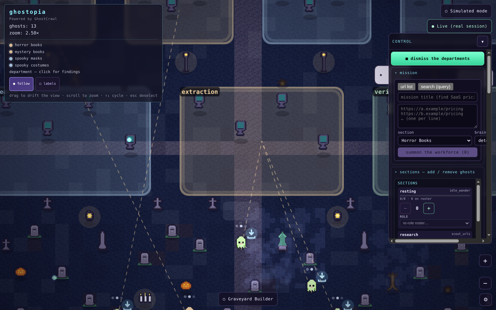
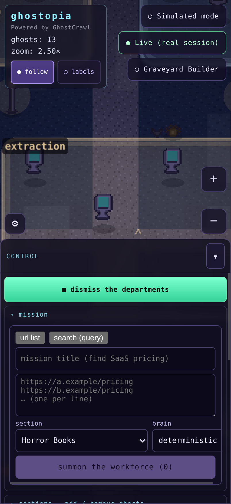

# ghostopia



**A visual scraping workforce, powered by [GhostCrawl](https://ghostcrawl.io).**

ghostopia turns your GhostCrawl account into a small pixel-art town. Every ghost
is a real GhostCrawl browser session. Type a product name (or paste product URLs),
and the workforce searches, visits pages, extracts offers, keeps **exact matches
only**, and files the cheapest results for CSV/JSON export.

You bring GhostCrawl (cloud or self-hosted); ghostopia is the thin program on top.
**GhostCrawl does all the browsing and scraping work** — ghostopia points a
workforce at your targets and shows you what it brings back.

- Marketing preview (facade demo): [ghostcrawl.io/ghostopia](https://ghostcrawl.io/ghostopia)
- Story: [Ghostopia: Your Scraping Workforce](https://ghostcrawl.io/blog/ghostopia-your-scraping-workforce/)

## Screenshots

| The workforce world | Best-price mission | On a phone |
| --- | --- | --- |
|  |  |  |

## Quickstart (3 steps)

You need [`uv`](https://docs.astral.sh/uv/), Node.js, and a GhostCrawl key.

```bash
git clone https://github.com/ghostcrawl/ghostopia.git
cd ghostopia
cp .env.example .env   # set GHOSTOPIA_GC_TOKEN + GHOSTOPIA_GC_BASE_URL (+ JWT secret)
make run               # open http://localhost:8000
```

Opens on **product search** with `Sony WH-1000XM5` preloaded. Click
**find the cheapest offers**. One-click examples also include Nintendo Switch OLED
and Dyson V15 Detect.

### What you type vs what you get

| You do | ghostopia does |
| --- | --- |
| Type a product name | Fan-out search across open catalogs via GhostCrawl |
| Or paste product URLs | Visit each page in a real browser and extract fields |
| Click find | Keep **exact** matches only; drop cases / accessories / near-misses |
| Open Data Graveyard | Export title / price / stock / link / image as CSV or JSON |

### The one `.env`

| Variable | What it is |
| --- | --- |
| `GHOSTOPIA_GC_TOKEN` | Your GhostCrawl key (stays on the server; never sent to the browser). |
| `GHOSTOPIA_GC_BASE_URL` | GhostCrawl endpoint — cloud `https://api.ghostcrawl.io` or your self-host (e.g. `http://localhost:47700`). |
| `GHOSTOPIA_JWT_SECRET` | Long random string for UI tokens (`openssl rand -hex 32`). |

Everything else in `.env.example` is optional with sensible defaults.

### Self-contained

This repo vendors the GhostCrawl Python SDK under `vendor/`. A plain `uv sync`
(via `make run`) resolves everything — no other checkout required.

## Powered by GhostCrawl

Every ghost is a real GhostCrawl session: Chrome, Firefox, or WebKit, coherent
identity, structured extraction. If you like what you see, start at
[ghostcrawl.io](https://ghostcrawl.io) or the
[API docs](https://docs.ghostcrawl.io).
